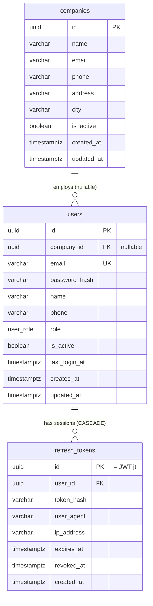
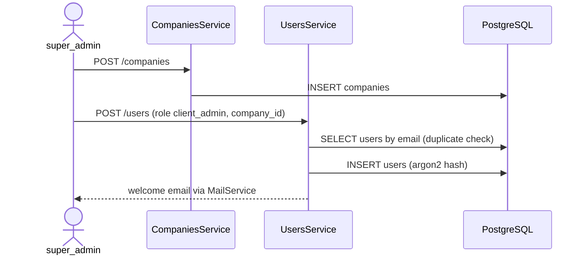
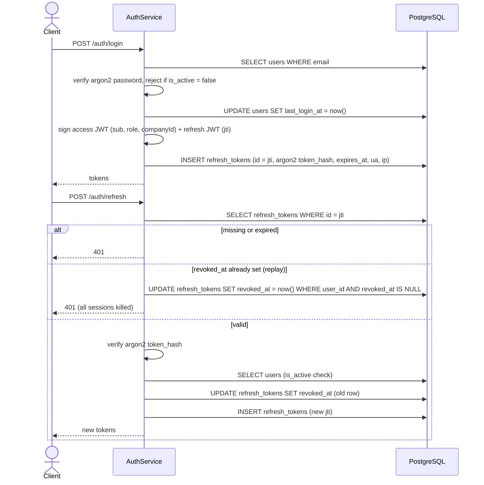
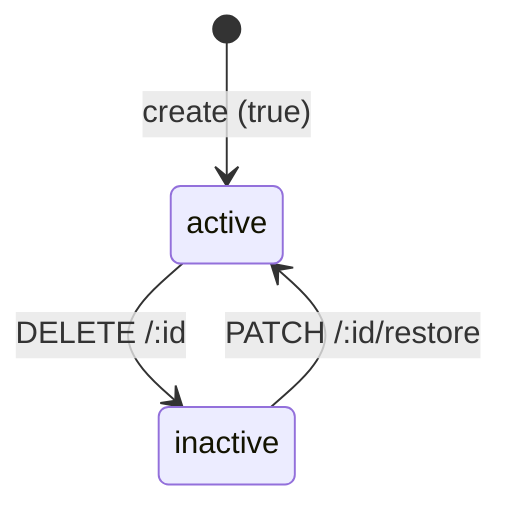

# RMS Database: Structure, ERD and Data Flows

PostgreSQL, accessed through **Drizzle ORM** (`pg` driver). The schema files in [`src/database/schema/`](../src/database/schema/) are the source of truth. Changes are written as migrations with `pnpm db:generate` and applied with `pnpm db:migrate`; the generated SQL in `src/database/migrations/` is committed.

> `0000_init.sql` is the baseline, generated from the current schema. Databases that were created earlier with `db:push` should have `0000_init` recorded in `drizzle.__drizzle_migrations` as applied instead of running its SQL.

## Contents

1. [Conventions](#1-conventions)
2. [Entity relationship diagram](#2-entity-relationship-diagram)
3. [Enums](#3-enums)
4. [Tables](#4-tables)
5. [Relationships](#5-relationships)
6. [Data flows](#6-data-flows)
7. [Status state machine](#7-status-state-machine)
8. [Scripts and seeds](#8-scripts-and-seeds)
9. [Known gaps](#9-known-gaps)

---

## 1. Conventions

| Topic | Rule |
|---|---|
| Primary key | `id uuid`, generated by the app with `uuidv7()` (`$defaultFn`), not by the database |
| Soft delete | `is_active boolean NOT NULL DEFAULT true` (`isActive` in Drizzle, `status` in the API). `DELETE` sets it to `false` and `PATCH /:id/restore` sets it back to `true`. Rows are never physically deleted, except refresh tokens. |
| Timestamps | `created_at` and `updated_at` are `timestamptz NOT NULL DEFAULT now()`. `updated_at` is also refreshed by the app with `$onUpdate`. The pool runs with `timezone=UTC`. |
| Column casing | camelCase in TypeScript, `snake_case` in the database (`casing: 'snake_case'`) |
| Multi-tenancy | `companies` are the tenants. `users.company_id` is nullable, because platform users (`super_admin`) have no company. |
| Foreign keys | `ON UPDATE no action`, and `ON DELETE RESTRICT` unless stated otherwise. Names follow `<table>_<col>_<ref>_<refcol>_fk`. |
| Pagination index | Every listable table has a `(created_at DESC, id DESC)` index for list ordering |
| Error mapping | Repository writes go through `withDatabaseErrors()`, which maps Postgres codes and constraint names to HTTP 400, 409 or 503 |

---

## 2. Entity relationship diagram

---

## 3. Enums

| Postgres enum | Values | Column |
|---|---|---|
| `user_role` | `super_admin`, `client_admin`, `manager`, `staff`, `customer` | `users.role` (default `staff`) |

---

## 4. Tables

### 4.1 `companies`: tenants

| Column | Type | Null | Default | Notes |
|---|---|---|---|---|
| id | uuid | NO | uuidv7() | PK |
| name | varchar(255) | NO | | |
| email | varchar(255) | YES | | |
| phone | varchar(32) | YES | | |
| address | varchar(500) | YES | | |
| city | varchar(100) | YES | | free text |
| is_active | boolean | NO | true | |
| created_at | timestamptz | NO | now() | |
| updated_at | timestamptz | NO | now() | |

Indexes: `companies_name_idx(name)`, `companies_is_active_idx(is_active)`, `companies_created_at_idx(created_at DESC, id DESC)`.

### 4.2 `users`

| Column | Type | Null | Default | Notes |
|---|---|---|---|---|
| id | uuid | NO | uuidv7() | PK |
| company_id | uuid | YES | | FK → `companies.id`, RESTRICT. NULL for `super_admin`. |
| email | varchar(255) | NO | | **unique**, used as the login |
| password_hash | varchar(255) | NO | | argon2id |
| name | varchar(150) | NO | | |
| phone | varchar(32) | YES | | |
| role | user_role | NO | `staff` | |
| is_active | boolean | NO | true | |
| last_login_at | timestamptz | YES | | |
| created_at | timestamptz | NO | now() | |
| updated_at | timestamptz | NO | now() | |

Indexes: **UNIQUE** `users_email_unique_idx(email)`, `users_role_idx`, `users_is_active_idx`, `users_created_at_idx(created_at DESC, id DESC)`, `users_company_created_at_idx(company_id, created_at DESC, id DESC)`.
CHECK `users_super_admin_has_no_company`: `role <> 'super_admin' OR company_id IS NULL`.

### 4.3 `refresh_tokens`

| Column | Type | Null | Default | Notes |
|---|---|---|---|---|
| id | uuid | NO | uuidv7() | PK, set to the refresh JWT `jti` |
| user_id | uuid | NO | | FK → `users.id`, **CASCADE** |
| token_hash | varchar(255) | NO | | argon2id hash of the refresh JWT |
| user_agent | varchar(255) | YES | | |
| ip_address | varchar(64) | YES | | |
| expires_at | timestamptz | NO | | from the JWT `exp` |
| revoked_at | timestamptz | YES | | NULL means active |
| created_at | timestamptz | NO | now() | no `updated_at` or `is_active` column |

Indexes: `refresh_tokens_user_id_idx(user_id)`, `refresh_tokens_expires_at_idx(expires_at)`.

---

## 5. Relationships

| Parent | Child column | Cardinality | On delete |
|---|---|---|---|
| companies | users.company_id | 1 : 0..N (nullable) | RESTRICT |
| users | refresh_tokens.user_id | 1 : 0..N | **CASCADE** |

Drizzle `relations()` are declared for all three tables.

---

## 6. Data flows

Every module follows `controller → service → repository`, and only repositories touch Drizzle.

**Who can call what**

| Role | Endpoints |
|---|---|
| `super_admin` | `/companies`, `/users` |
| Public | `/auth/register`, `/auth/login`, `/auth/refresh`, `/auth/logout` |
| Any authenticated user | `/auth/me`, `/auth/logout-all` |

**Common to every list endpoint:** it is paginated, searchable with ILIKE, and sorted by `created_at DESC, id DESC`.

**Common to every DELETE and restore endpoint:** it returns 409 if the row is already in the target state, then runs `UPDATE … SET is_active = false/true`.

### 6.1 Company onboarding

**Deactivating a company** is refused with 409 while any active users remain (`countActiveByCompany`).

### 6.2 Authentication: login, refresh and logout

- **Register** (`POST /auth/register`) creates a `customer` user, then issues tokens the same way as login.
- **Logout** revokes the token's own row. **Logout-all** revokes every active row for the user.

### 6.3 Health

`GET /health/readiness` pings the database through `database.health-indicator.ts`.

---

## 7. Status state machine

`is_active` (soft delete, on `companies` and `users`; `status` in the API):

---

## 8. Scripts and seeds

| Command | Entry point | Effect on the database |
|---|---|---|
| `pnpm db:generate` | drizzle-kit | None. Writes the next migration SQL from schema changes |
| `pnpm db:migrate` | drizzle-kit | Applies pending migrations and records them in `drizzle.__drizzle_migrations` |
| `pnpm db:push` | drizzle-kit | Applies the schema files directly, without a migration. Throwaway local prototyping only |
| `pnpm db:seed` | `src/database/seeds/run-seed.ts` | Idempotent. Creates the `super_admin` user from `SEED_SUPER_ADMIN_*`. |
| `pnpm db:seed:demo` | `src/database/seeds/run-demo-seed.ts` | Blocked in production. Skips if the demo admin exists. Runs **one transaction** that inserts a demo company, then its `client_admin` from `SEED_DEMO_ADMIN_*` (password `SEED_SUPER_ADMIN_PASSWORD`). |
| `pnpm db:reset` | `scripts/reset-db.ts` | Blocked in production. Truncates every table in the `public` schema (`RESTART IDENTITY CASCADE`), keeping the schema; run `db:seed` afterwards. |

There are no cron jobs or queues.

---

## 9. Known gaps

1. **Expired refresh tokens are never purged.** `RefreshTokensRepository.deleteExpired()` exists, but nothing calls it.
2. **Refresh rotation is not atomic.** Revoking the old token and inserting the new one are separate statements, so two concurrent refreshes with the same token can both succeed.
3. **Search cannot use an index.** Every list search is `ILIKE '%term%'`; a `pg_trgm` index would be needed for large tables.
