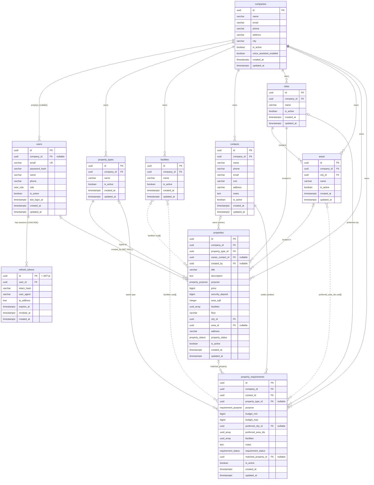
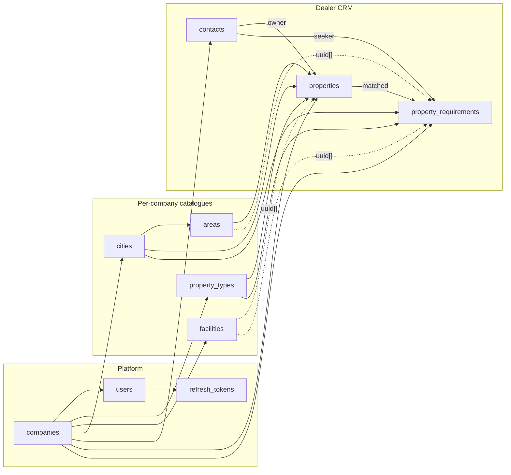
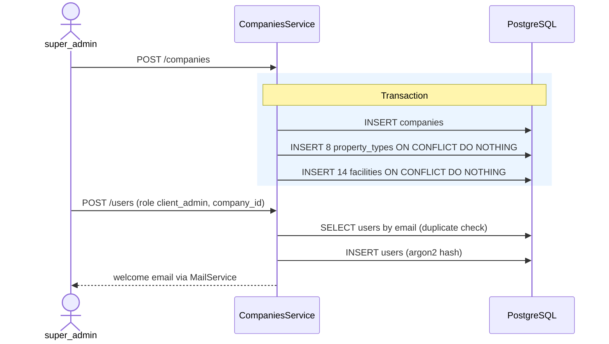
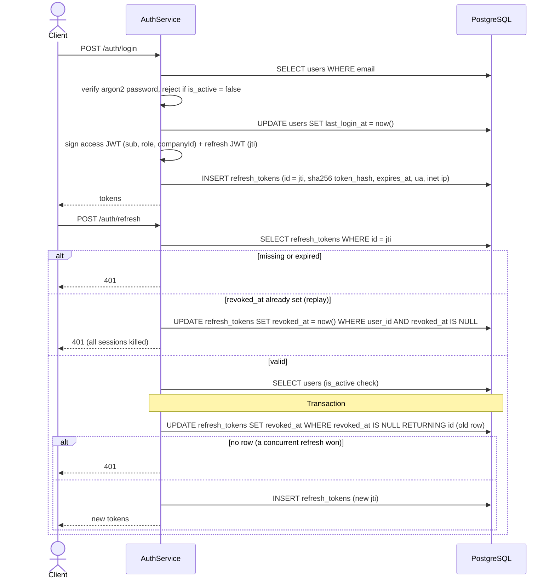
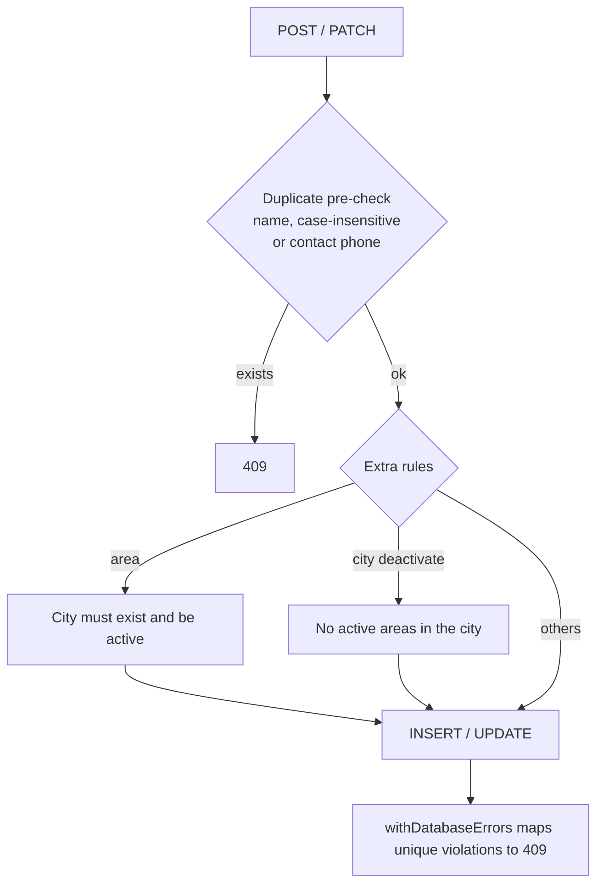
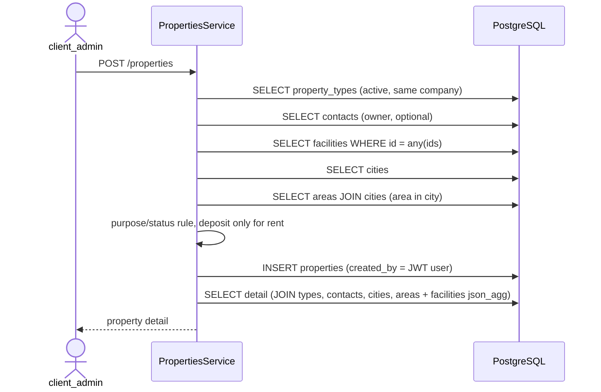
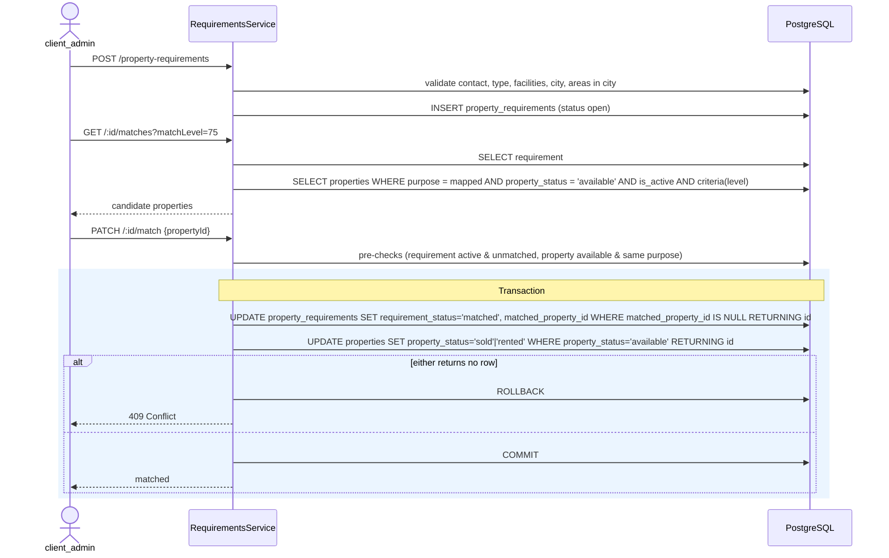
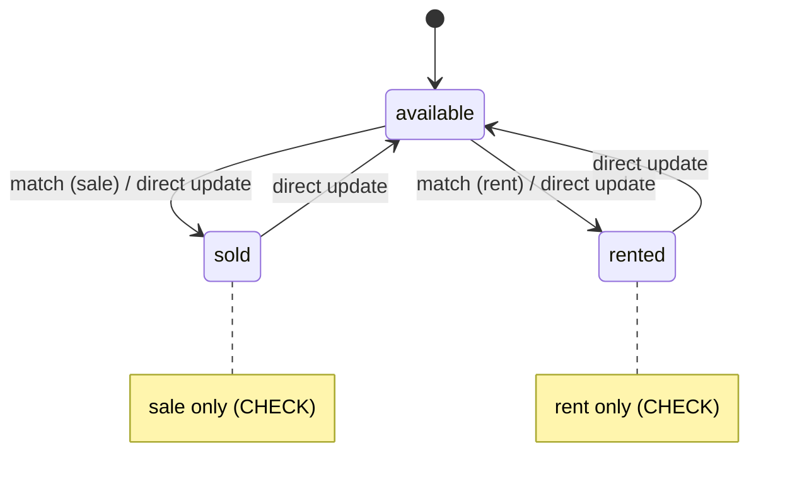
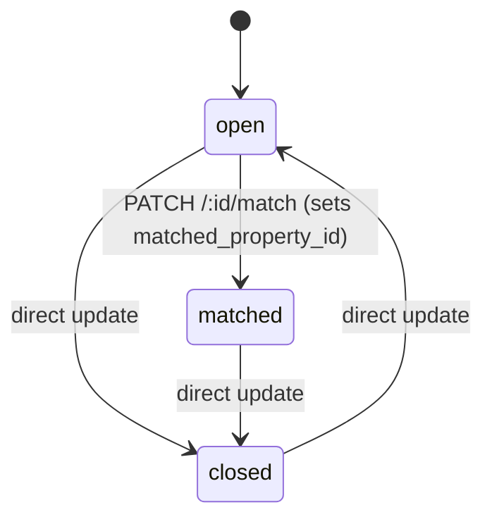
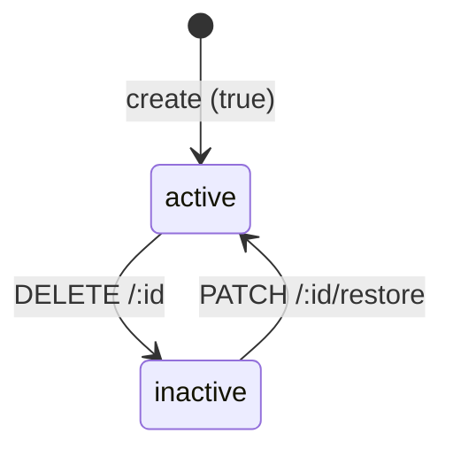

# RMS Database: Structure, ERD and Data Flows

PostgreSQL, accessed through **Drizzle ORM** (`pg` driver). The schema files in [`src/database/schema/`](../src/database/schema/) are the source of truth. Changes are applied with `pnpm db:push`, and no migrations are committed.

> `src/database/migrations/0000_init.sql` is **stale**. It describes an early version with only `companies`, `users` and `refresh_tokens`, and older columns such as `slug`, `username` and `deleted_at`. Do not read the current schema from it.

## Contents

1. [Conventions](#1-conventions)
2. [Entity relationship diagram](#2-entity-relationship-diagram)
3. [Enums](#3-enums)
4. [Tables](#4-tables)
5. [Relationships](#5-relationships)
6. [Data flows](#6-data-flows)
7. [Status state machines](#7-status-state-machines)
8. [Scripts and seeds](#8-scripts-and-seeds)
9. [Known gaps](#9-known-gaps)

---

## 1. Conventions

| Topic | Rule |
|---|---|
| Primary key | `id uuid`, generated by the app with `uuidv7()` (`$defaultFn`), not by the database |
| Soft delete | `is_active boolean NOT NULL DEFAULT true` (`isActive` in Drizzle, `status` in the API). `DELETE` sets it to `false` and `PATCH /:id/restore` sets it back to `true`. Rows are never physically deleted, except refresh tokens. |
| Timestamps | `created_at` and `updated_at` are `timestamptz NOT NULL DEFAULT now()`. `updated_at` is also refreshed by the app with `$onUpdate`. The pool runs with `timezone=UTC`. |
| Column casing | camelCase in TypeScript, `snake_case` in the database (`casing: 'snake_case'`) |
| Multi-tenancy | Every dealer table has a NOT NULL `company_id`. Repositories always filter by the `companyId` from the JWT. `users.company_id` is nullable, because platform users have no company. |
| Foreign keys | `ON UPDATE no action`, and `ON DELETE RESTRICT` unless stated otherwise. References between dealer tables are composite and include `company_id` (`<table>_company_<ref>_fk`), so a row can never point at another company's row. Single-column keys follow `<table>_<col>_<ref>_<refcol>_fk`. |
| Pagination index | Every table has a `(company_id, created_at DESC, id DESC)` or `(created_at DESC, id DESC)` index for list ordering |
| Error mapping | Repository writes go through `withDatabaseErrors()`, which maps Postgres codes and constraint names to HTTP 400, 409 or 503 |

---

## 2. Entity relationship diagram

Solid lines are real foreign keys. The `uuid[]` array columns (`facilities`, `preferred_area_ids`) have **no FK**. They are shown as dotted "references" lines.

### Domain overview

---

## 3. Enums

| Postgres enum | Values | Column |
|---|---|---|
| `user_role` | `super_admin`, `client_admin`, `manager`, `staff`, `customer` | `users.role` (default `staff`) |
| `property_purpose` | `sale`, `rent` | `properties.purpose` |
| `property_status` | `available`, `sold`, `rented` | `properties.property_status` (default `available`) |
| `requirement_purpose` | `buy`, `rent` | `property_requirements.purpose` |
| `requirement_status` | `open`, `matched`, `closed` | `property_requirements.requirement_status` (default `open`) |

**Mapping constants used by the app**

| Constant | Mapping |
|---|---|
| `CLOSING_STATUS_BY_PURPOSE` | `sale` → `sold`, `rent` → `rented` |
| `LISTING_PURPOSE_FOR_REQUIREMENT` | `buy` → `sale`, `rent` → `rent` |
| `MATCH_LEVELS` | `100`, `75` (default), `50`, `25`, `0` |

---

## 4. Tables

### 4.1 `companies`: tenants (the dealerships)

| Column | Type | Null | Default | Notes |
|---|---|---|---|---|
| id | uuid | NO | uuidv7() | PK |
| name | varchar(255) | NO | | |
| email | varchar(255) | YES | | lower-cased by the service |
| phone | varchar(32) | YES | | |
| address | varchar(500) | YES | | |
| city | varchar(100) | YES | | free text, not a FK |
| is_active | boolean | NO | true | |
| voice_assistant_enabled | boolean | NO | false | turns on the Gemini assistant |
| created_at | timestamptz | NO | now() | |
| updated_at | timestamptz | NO | now() | |

Indexes: `companies_created_at_idx(created_at DESC, id DESC)`.

### 4.2 `users`

| Column | Type | Null | Default | Notes |
|---|---|---|---|---|
| id | uuid | NO | uuidv7() | PK |
| company_id | uuid | YES | | FK → `companies.id`, RESTRICT. NULL for `super_admin`. |
| email | varchar(255) | NO | | **unique**, used as the login |
| password_hash | varchar(255) | NO | | argon2id |
| name | varchar(150) | NO | | |
| phone | varchar(32) | YES | | |
| role | user_role | NO | `staff` | |
| is_active | boolean | NO | true | |
| last_login_at | timestamptz | YES | | |
| created_at | timestamptz | NO | now() | |
| updated_at | timestamptz | NO | now() | |

Indexes: **UNIQUE** `users_email_unique_idx(email)`, `users_created_at_idx`, `users_company_created_at_idx(company_id, created_at DESC, id DESC)`.
CHECK `users_super_admin_has_no_company`: `role <> 'super_admin' OR company_id IS NULL`.
CHECK `users_email_lowercase`: `email = lower(email)`, so the unique index is effectively case-insensitive.

### 4.3 `refresh_tokens`

| Column | Type | Null | Default | Notes |
|---|---|---|---|---|
| id | uuid | NO | uuidv7() | PK, set to the refresh JWT `jti` |
| user_id | uuid | NO | | FK → `users.id`, **CASCADE** |
| token_hash | varchar(64) | NO | | hex SHA-256 of the refresh JWT |
| user_agent | varchar(255) | YES | | truncated to 255 characters |
| ip_address | inet | YES | | NULL when the request IP is not a valid address |
| expires_at | timestamptz | NO | | from the JWT `exp` |
| revoked_at | timestamptz | YES | | NULL means active |
| created_at | timestamptz | NO | now() | no `updated_at` or `is_active` column |

Indexes: partial `refresh_tokens_active_user_id_idx(user_id) WHERE revoked_at IS NULL`, `refresh_tokens_expires_at_idx(expires_at)`.

### 4.4 `property_types`: per-company catalogue

| Column | Type | Null | Default | Notes |
|---|---|---|---|---|
| id | uuid | NO | uuidv7() | PK |
| company_id | uuid | NO | | FK → `companies.id` |
| name | varchar(100) | NO | | |
| is_active | boolean | NO | true | |
| created_at / updated_at | timestamptz | NO | now() | |

Indexes: **UNIQUE** `property_types_company_name_unique_idx(company_id, lower(name))`, **UNIQUE** `property_types_company_id_id_unique(company_id, id)` (composite FK target), `property_types_company_created_at_idx`.

### 4.5 `facilities`: per-company catalogue

This table has the same columns as `property_types`.
Indexes: **UNIQUE** `facilities_company_name_unique_idx(company_id, lower(name))`, `facilities_company_created_at_idx`.

### 4.6 `contacts`: property owners and seekers (they never log in)

| Column | Type | Null | Default | Notes |
|---|---|---|---|---|
| id | uuid | NO | uuidv7() | PK |
| company_id | uuid | NO | | FK → `companies.id` |
| name | varchar(150) | NO | | |
| phone | varchar(11) | NO | | unique per company, exactly `03` + 9 digits |
| email | varchar(255) | YES | | |
| cnic | varchar(15) | YES | | Pakistani national ID, `35202-1234567-1` (dashes optional) |
| address | varchar(500) | YES | | |
| notes | text | YES | | |
| is_active | boolean | NO | true | |
| created_at / updated_at | timestamptz | NO | now() | |

Indexes: **UNIQUE** `contacts_company_phone_unique_idx(company_id, phone)`, **UNIQUE** `contacts_company_id_id_unique(company_id, id)`, `contacts_company_created_at_idx`.
CHECK `contacts_phone_format`: `phone ~ '^03[0-9]{9}$'`. CHECK `contacts_cnic_format`: `cnic IS NULL OR cnic ~ '^[0-9]{5}-?[0-9]{7}-?[0-9]$'`.

### 4.7 `cities`

| Column | Type | Null | Default | Notes |
|---|---|---|---|---|
| id | uuid | NO | uuidv7() | PK |
| company_id | uuid | NO | | FK → `companies.id` |
| name | varchar(100) | NO | | |
| is_active | boolean | NO | true | |
| created_at / updated_at | timestamptz | NO | now() | |

Indexes: **UNIQUE** `cities_company_name_unique_idx(company_id, lower(name))`, **UNIQUE** `cities_company_id_id_unique(company_id, id)`, `cities_company_created_at_idx`.

### 4.8 `areas`: localities inside a city

| Column | Type | Null | Default | Notes |
|---|---|---|---|---|
| id | uuid | NO | uuidv7() | PK |
| company_id | uuid | NO | | FK → `companies.id` |
| city_id | uuid | NO | | FK `(company_id, city_id)` → `cities(company_id, id)` |
| name | varchar(150) | NO | | unique per city, case-insensitive |
| is_active | boolean | NO | true | |
| created_at / updated_at | timestamptz | NO | now() | |

Indexes: **UNIQUE** `areas_city_name_unique_idx(city_id, lower(name))`, **UNIQUE** `areas_city_id_id_unique(city_id, id)` (target of `properties_city_area_fk`), `areas_company_created_at_idx`, `areas_city_created_at_idx`.

### 4.9 `properties`: listings

| Column | Type | Null | Default | Notes |
|---|---|---|---|---|
| id | uuid | NO | uuidv7() | PK |
| company_id | uuid | NO | | FK → `companies.id` |
| property_type_id | uuid | NO | | FK `(company_id, property_type_id)` → `property_types` |
| owner_contact_id | uuid | YES | | FK `(company_id, owner_contact_id)` → `contacts` |
| created_by | uuid | YES | | FK → `users.id`, **SET NULL** |
| title | varchar(200) | NO | | |
| description | text | YES | | |
| purpose | property_purpose | NO | | |
| price | bigint | NO | | sale price or monthly rent, in whole rupees |
| security_deposit | bigint | YES | | rent listings only |
| area_sqft | integer | YES | | |
| facilities | uuid[] | NO | `'{}'` | facility ids, **no FK** |
| floor | varchar(50) | YES | | |
| city_id | uuid | NO | | FK `(company_id, city_id)` → `cities` |
| area_id | uuid | YES | | FK `(city_id, area_id)` → `areas(city_id, id)`, so the area must belong to `city_id` |
| address | varchar(500) | YES | | |
| property_status | property_status | NO | `available` | where the deal stands |
| is_active | boolean | NO | true | active / deactivated |
| created_at / updated_at | timestamptz | NO | now() | |

Indexes: **UNIQUE** `properties_company_id_id_unique(company_id, id)`, `properties_company_created_at_idx`, `properties_company_purpose_status_idx(company_id, purpose, property_status)`, `properties_property_type_idx`, `properties_owner_contact_idx`, `properties_city_area_idx(city_id, area_id)`, `properties_area_idx`, **GIN** `properties_facilities_idx(facilities)` (serves `@>`).

CHECK constraints:

| Name | Rule |
|---|---|
| `properties_price_non_negative` | `price >= 0` |
| `properties_deposit_non_negative` | `security_deposit IS NULL OR security_deposit >= 0` |
| `properties_area_sqft_positive` | `area_sqft IS NULL OR area_sqft > 0` |
| `properties_deposit_only_for_rent` | `purpose = 'rent' OR security_deposit IS NULL` |
| `properties_status_matches_purpose` | a `sale` listing can't be `rented`, and a `rent` listing can't be `sold` |

### 4.10 `property_requirements`: what a seeker wants

| Column | Type | Null | Default | Notes |
|---|---|---|---|---|
| id | uuid | NO | uuidv7() | PK |
| company_id | uuid | NO | | FK → `companies.id` |
| contact_id | uuid | NO | | FK `(company_id, contact_id)` → `contacts` (the seeker) |
| property_type_id | uuid | YES | | FK `(company_id, property_type_id)` → `property_types`. NULL means any type. |
| purpose | requirement_purpose | NO | | |
| budget_min | bigint | YES | | |
| budget_max | bigint | YES | | |
| preferred_city_id | uuid | YES | | FK `(company_id, preferred_city_id)` → `cities`. NULL means any city. |
| preferred_area_ids | uuid[] | NO | `'{}'` | area ids, **no FK**, at most 50 |
| facilities | uuid[] | NO | `'{}'` | required facility ids, **no FK** |
| notes | text | YES | | |
| requirement_status | requirement_status | NO | `open` | |
| matched_property_id | uuid | YES | | FK `(company_id, matched_property_id)` → `properties` |
| is_active | boolean | NO | true | |
| created_at / updated_at | timestamptz | NO | now() | |

Indexes: `property_requirements_company_created_at_idx`, `property_requirements_contact_idx`, `property_requirements_matched_property_idx`, `property_requirements_company_status_idx(company_id, requirement_status)`.
CHECK constraints:

| Name | Rule |
|---|---|
| `property_requirements_budget_range` | `budget_min IS NULL OR budget_max IS NULL OR budget_min <= budget_max` |
| `property_requirements_budget_non_negative` | both budgets are NULL or `>= 0` |
| `property_requirements_max_preferred_areas` | `cardinality(preferred_area_ids) <= 50` |
| `property_requirements_areas_need_city` | `preferred_city_id IS NOT NULL OR cardinality(preferred_area_ids) = 0` |
| `property_requirements_matched_has_property` | `requirement_status <> 'matched' OR matched_property_id IS NOT NULL` |

---

## 5. Relationships

| Parent | Child column | Cardinality | On delete |
|---|---|---|---|
| companies | users.company_id | 1 : 0..N (nullable) | RESTRICT |
| users | refresh_tokens.user_id | 1 : 0..N | **CASCADE** |
| companies | property_types / facilities / contacts / cities / areas / properties / property_requirements `.company_id` | 1 : 0..N | RESTRICT |
| cities | areas.city_id | 1 : 0..N | RESTRICT |
| cities | properties.city_id | 1 : 0..N | RESTRICT |
| cities | property_requirements.preferred_city_id | 0..1 : 0..N | RESTRICT |
| areas | properties.area_id | 0..1 : 0..N | RESTRICT |
| property_types | properties.property_type_id | 1 : 0..N | RESTRICT |
| property_types | property_requirements.property_type_id | 0..1 : 0..N | RESTRICT |
| contacts | properties.owner_contact_id | 0..1 : 0..N | RESTRICT |
| contacts | property_requirements.contact_id | 1 : 0..N | RESTRICT |
| users | properties.created_by | 0..1 : 0..N | **SET NULL** |
| properties | property_requirements.matched_property_id | 0..1 : 0..N (in practice 0..1) | RESTRICT |
| facilities | properties.facilities[] | M : N | none (array) |
| facilities | property_requirements.facilities[] | M : N | none (array) |
| areas | property_requirements.preferred_area_ids[] | M : N | none (array) |

Drizzle `relations()` are declared only for `companies`, `users` and `refresh_tokens`. Every other join is written by hand in the repositories. The array columns are resolved for reads by `buildIdNameList()` (`src/common/utils/id-name-list.util.ts`), which runs a `json_agg` subquery with `= any(array)`.

---

## 6. Data flows

Every module follows `controller → service → repository`, and only repositories touch Drizzle.

**Who can call what**

| Role | Endpoints |
|---|---|
| `super_admin` | `/companies`, `/users` |
| `client_admin` | `/property-types`, `/facilities`, `/contacts`, `/cities`, `/areas`, `/properties`, `/property-requirements`, `/assistant` |
| Public | `/auth/*` (`logout-all` and `me` use the caller's own token) |

**Common to every list endpoint:** it is paginated, searchable with ILIKE, sorted by `created_at DESC, id DESC`, and runs the count and page queries together with `Promise.all`.

**Common to every DELETE and restore endpoint:** it returns 409 if the row is already in the target state, then runs `UPDATE … SET is_active = false/true`.

### 6.1 Company onboarding

- **Default property types:** House, Portion, Room, Flat, Shop, Office, Plot, Warehouse.
- **Default facilities:** 1/2/3/4+ bedrooms, 1/2/3+ bathrooms, Attached bath, Furnished, Semi-furnished, Parking, Separate entrance, Gas, Electricity backup.
- **Deactivating a company** is refused with 409 while any active users remain (`SELECT count(*) FROM users WHERE company_id = ? AND is_active = true`).

### 6.2 Authentication: login, refresh and logout

- **Register** (`POST /auth/register`) creates a `customer` user, then issues tokens the same way as login.
- **Logout** revokes the token's own row. **Logout-all** revokes every active row for the user.

### 6.3 Reference data (types, facilities, contacts, cities, areas)

Writes to properties and requirements first run `assertUsable`, `assertAllUsable` or `assertAllInCity`. The referenced rows must exist, belong to the company and be active. Records that were already linked may stay even if they have since been deactivated.

### 6.4 Create or update a property

Update rules:
- If the city changes and no area is given, `area_id` is cleared.
- If purpose becomes `sale`, `security_deposit` is cleared.
- Only newly added facilities must be active.

List filters: purpose, type, property_status, owner, status, price range, facilities (`@>`), city, and areas `IN (…)`. Search covers title, city name, area name and address.

### 6.5 Property requirement and matching

**Criteria checked at each match level**

| Level | Type | City | Area | Budget | Facilities |
|---|:-:|:-:|:-:|:-:|:-:|
| 100 | ✓ | ✓ | ✓ | ✓ | ✓ |
| 75 (default) | ✓ | ✓ | ✓ | ✓ | |
| 50 | ✓ | ✓ | | ✓ | |
| 25 | ✓ | ✓ | | | |
| 0 | ✓ | | | | |

A NULL value on the requirement side (any type, any city, no budget) is not filtered on.

### 6.6 Voice assistant

`POST /assistant/session` reads `companies.voice_assistant_enabled`. If it is true, the service requests a single-use Gemini Live token. It makes **no database writes**.

### 6.7 Health

`GET /health/readiness` pings the database through `database.health-indicator.ts`.

---

## 7. Status state machines

### `properties.property_status`

### `property_requirements.requirement_status`

Only the match endpoint sets `matched_property_id`, and nothing clears it.

### `is_active` (soft delete, every table except refresh_tokens; `status` in the API)

---

## 8. Scripts and seeds

| Command | Entry point | Effect on the database |
|---|---|---|
| `pnpm db:push` | drizzle-kit | Applies the schema files to the database |
| `pnpm db:seed` | `src/database/seeds/run-seed.ts` | Idempotent. Creates the `super_admin` user. |
| `pnpm db:seed:demo` | `src/database/seeds/run-demo-seed.ts` | Blocked in production. Runs **one transaction** that inserts companies → users → property_types → contacts → facilities → cities/areas → properties → property_requirements, with timestamps backdated over several months. |
| `pnpm db:reset` | `scripts/reset-db.ts` | Blocked in production. `TRUNCATE` of every public table with `RESTART IDENTITY CASCADE`. |

There are no cron jobs or queues.

---

## 9. Known gaps

1. **No referential integrity on `uuid[]` columns.** `facilities` and `preferred_area_ids` are checked only on write, so deactivated or orphaned ids can remain in them. Composite FKs cannot cover array elements.
2. **Expired refresh tokens are never purged.** `RefreshTokensRepository.deleteExpired()` exists, but nothing calls it.
3. **The migration file is stale.** `0000_init.sql` does not reflect the current schema, and production still relies on `db:push`.
4. **Constraint error mapping is incomplete.** `COMPANY_CONSTRAINT_MESSAGES` maps only `users_company_id_companies_id_fk`.
5. **Search cannot use an index.** Every list search is `ILIKE '%term%'`. A `pg_trgm` index only helps when every OR'd column is indexed on the same table, and property search also matches joined city and area names, so it needs a dedicated search column before trigram indexes pay off.
